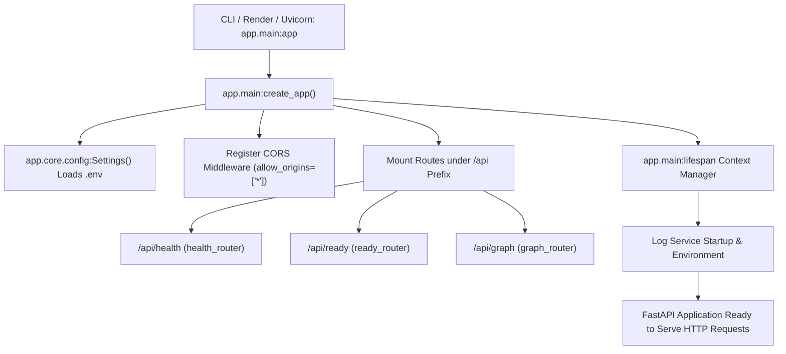
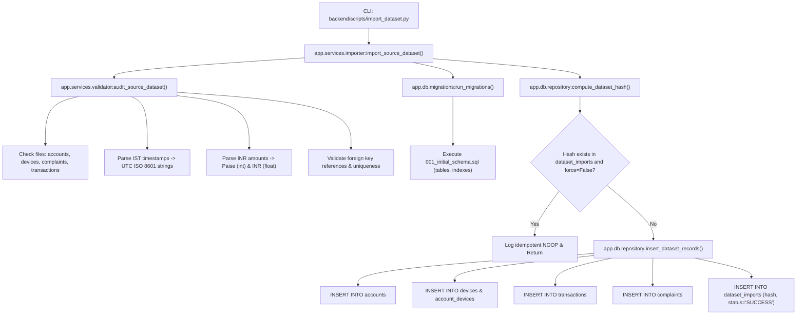
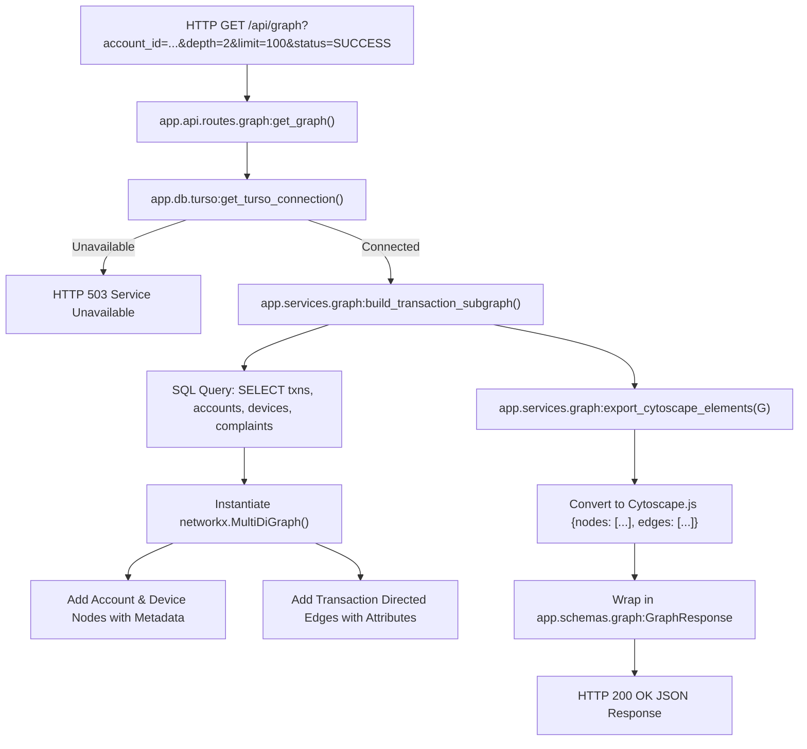
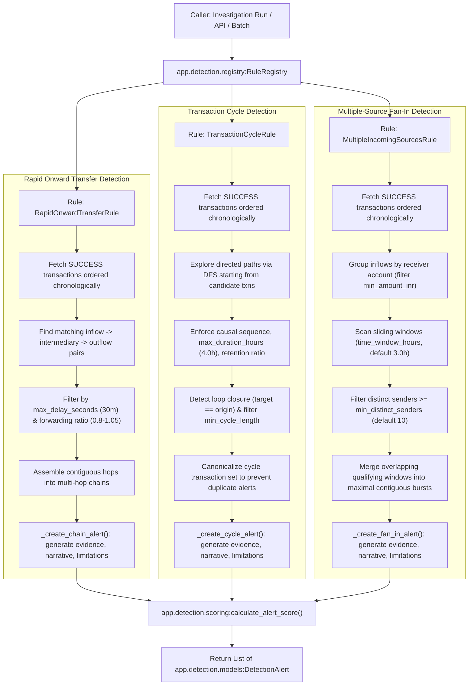
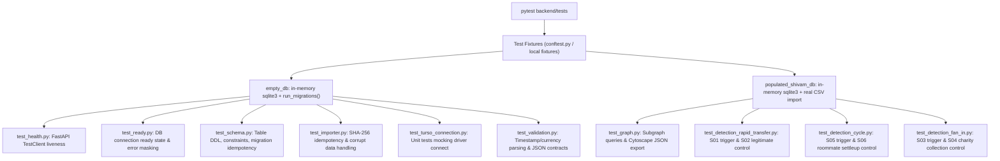

# Backend Execution Flow and Architecture Map (FLOW.md)

This document traces the actual runtime execution paths across files, functions, modules, and database operations in the **Anvik** backend and detection engine. All paths are derived from verified source code inspection.

---

## 1. Startup Flow

The backend service is powered by FastAPI and managed via Uvicorn.

### Execution Steps
1. **Application Instantiation:** Uvicorn targets `app.main:app`, which is initialized via `app.main:create_app()`.
2. **Configuration Loading:** `app.core.config.Settings` reads environment variables (`TURSO_DATABASE_URL`, `TURSO_AUTH_TOKEN`, `ENVIRONMENT`). Secret tokens are masked from string representation.
3. **Lifespan Startup:** `app.main:lifespan()` executes, logging startup state and configuring the application lifecycle without establishing eager database connections on import.
4. **Router Mounting:**
   - `backend/app/api/routes/health.py`: Mounted at `/api/health`. Returns immediate 200 OK liveness status (`{"status": "healthy", "service": "anvik-backend"}`) independently of database state.
   - `backend/app/api/routes/ready.py`: Mounted at `/api/ready`. Probes database readiness using `app.db.turso.check_connection()` and returns 200 OK or 503 Service Unavailable without leaking tokens.
   - `backend/app/api/routes/graph.py`: Mounted at `/api/graph`. Serves transaction subgraph queries for Cytoscape.js.

---

## 2. Dataset Import Flow

The data import pipeline takes raw synthetic CSV files from Shivam, validates them against strict financial schemas, and writes them idempotently into Turso or local SQLite.

### Execution Steps
1. **Entry Point:** Invoked via `backend/scripts/import_dataset.py:main()` or directly via `app.services.importer:import_source_dataset()`.
2. **Data Audit & Normalization:** `app.services.validator:audit_source_dataset()` audits incoming CSVs:
   - Verifies mandatory files (`accounts.csv`, `devices.csv`, `transactions.csv`, `complaints.csv`). Note: absence of `merchants.csv` is gracefully accepted.
   - Calls `parse_ist_timestamp()` to convert naive Indian Standard Time strings to timezone-aware UTC strings.
   - Calls `parse_inr_amount()` to validate decimal precision ($\le 2$ decimal places) and generate integer paise values.
3. **Schema Migrations:** `app.db.migrations:run_migrations()` inspects `schema_migrations` and applies `backend/migrations/001_initial_schema.sql` if unapplied.
4. **Content-Addressable Hashing:** `app.db.repository:compute_dataset_hash()` generates a SHA-256 fingerprint over normalized records. If already present in `dataset_imports`, re-ingestion is skipped as a clean no-op unless `force=True`.
5. **Database Transaction:** Inserts normalized records into `accounts`, `devices`, `account_devices`, `transactions`, and `complaints`, committing an import audit record.

---

## 3. Graph API Flow

The graph endpoint provides subgraphs formatted specifically for Cytoscape.js rendering in Piyush's frontend UI.

### Execution Steps
1. **Request Intake:** Client sends `GET /api/graph` with optional filters (`account_id`, `depth`, `limit`, `status`).
2. **Database Session:** Handler requests a thread-safe connection via `app.db.turso:get_turso_connection()`.
3. **Graph Construction:** `app.services.graph:build_transaction_subgraph()` runs SQL queries to extract nodes and directed transaction edges:
   - When `account_id` is specified, performs bounded ego-subgraph expansion up to `depth` hops.
   - When `account_id` is omitted, loads the most recent transactions up to `limit`.
4. **NetworkX Modeling:** Edges are added to an in-memory `networkx.MultiDiGraph`, preserving parallel transactions between accounts.
5. **Cytoscape Export:** `app.services.graph:export_cytoscape_elements()` translates NetworkX nodes and multigraph edges into standard Cytoscape elements (`data.id`, `data.source`, `data.target`, `data.amount_inr`, `data.status`).

---

## 4. Detection Engine Flow

The detection engine executes explainable, modular rules over preloaded transaction and complaint records.

### Execution Steps
1. **Registry Coordination:** `app.detection.registry:RuleRegistry` maintains all active rule instances. Calling `registry.run_all(conn)` or `registry.run_rule(rule_id, conn)` dispatches detection against an active database connection. Rules can be queried by canonical ID or configured aliases.
2. **Rule 1 — Rapid Onward Transfer:**
   - Implemented in `app.detection.rules.rapid_transfer:RapidOnwardTransferRule`.
   - Queries `SUCCESS` transactions ordered chronologically.
   - Matches incoming transactions to intermediary accounts with rapid subsequent outflows within `max_delay_seconds` (default: 1800s / 30m) and amount ratio within $[0.80, 1.05]$.
   - Links consecutive hops into forwarding chains ($A \to B \to C \to D$).
   - Generates deterministic alert ID (`alt_rot_<hash>`), structured `HopEvidence`, and explainable narrative.
3. **Rule 2 — Transaction Cycle:**
   - Implemented in `app.detection.rules.transaction_cycle:TransactionCycleRule`.
   - Queries `SUCCESS` transactions ordered chronologically.
   - Traverses directed paths using bounded DFS to discover closed loops ($A \to B \to C \to A$) within `max_duration_hours` (default: 4.0h) retaining $\ge 70\%$ of funds.
   - Enforces chronological sequence ($t_{i+1} > t_i$) and eliminates non-circular settlements.
   - Deduplicates cycle alerts across starting perspectives using canonical sorted transaction key.
   - Generates deterministic alert ID (`alt_cyc_<hash>`), structured evidence payload, and decision-support caveats.
4. **Rule 3 — Multiple-Source Fan-In:**
   - Implemented in `app.detection.rules.multi_source_fan_in:MultipleIncomingSourcesRule` (canonical ID: `multiple_incoming_sources`, alias: `multiple_source_fan_in`).
   - Groups `SUCCESS` inflows by receiver account.
   - Uses sliding-window evaluation over `time_window_hours` (default: 3.0h) and merges overlapping windows into maximal contiguous bursts.
   - Triggers when distinct sender count $\ge \text{min\_distinct\_senders}$ (default: 10), naturally isolating rapid fraud surges ($S03\_MANY\_SOURCES$, 30 senders in 2.81h) from multi-day charity collections ($S04\_CHARITY\_COLLECTION$, max 5 senders in 3h).
   - Generates deterministic alert ID (`alt_fanin_<hash>`), structured evidence, narrative, limitations, and alternative explanations.
5. **Scoring:** All rules delegate prioritization scoring to `app.detection.scoring:calculate_alert_score()`. Scores are bounded in $[0.0, 100.0]$ and remain modular pending Aryan's finalized formula.
6. **Output Serialization:** Findings are emitted as `app.detection.models:DetectionAlert` objects with embedded Cytoscape graph contexts.

---

## 5. Automated Test Flow

All backend tests are hermetic and run locally without requiring active network connectivity or cloud database credentials.

### Execution Steps
1. **Unit Tests (Hermetic):**
   - Use `fastapi.testclient.TestClient` for HTTP testing without spawning external server processes.
   - Use Python's standard `sqlite3.connect(":memory:")` with `run_migrations()` to test SQL DDL, indexes, and constraints.
   - Use `unittest.mock` to verify Turso driver behavior and failure modes without outbound network calls.
2. **Ground-Truth Scenario Tests:**
   - Use `populated_shivam_db` fixture to import Shivam's synthetic dataset into an in-memory SQLite instance.
   - Verify that positive scenario $S01\_RAPID\_CHAIN$ triggers `RAPID_ONWARD_TRANSFER` and negative control $S02\_SHOP\_SUPPLIER$ does not.
   - Verify that positive scenario $S05\_CYCLE$ triggers `TRANSACTION_CYCLE` and negative control $S06\_ROOMMATE\_SETTLEUP$ does not.
   - Verify that positive scenario $S03\_MANY\_SOURCES$ triggers `multiple_incoming_sources` and negative control $S04\_CHARITY\_COLLECTION$ does not.
   - Verify idempotency: running detection multiple times produces identical alert IDs and outputs.

---

## 6. File-to-Responsibility Table

| File Path | Component | Responsibility |
|---|---|---|
| `backend/app/main.py` | Application Core | FastAPI application factory, lifespan management, CORS middleware, route mounting. |
| `backend/app/core/config.py` | Configuration | Pydantic Settings loading environment variables and masking secret credentials. |
| `backend/app/db/turso.py` | Database Driver | Turso serverless connection factory and health-check execution with safe error sanitization. |
| `backend/app/db/migrations.py` | Schema Management | Versioned migration runner tracking applied versions in `schema_migrations`. |
| `backend/app/db/repository.py` | Data Persistence | Atomic database insert operations and SHA-256 dataset import fingerprinting. |
| `backend/migrations/001_initial_schema.sql` | SQL DDL | Relational schema for accounts, devices, transactions, complaints, and import logs. |
| `backend/app/services/validator.py` | Data Validation | Dataset CSV schema audit, IST-to-UTC conversion, and INR paise parsing. |
| `backend/app/services/importer.py` | Import Service | Orchestrates validation, migration, hashing, and database persistence. |
| `backend/app/services/graph.py` | Graph Engine | Queries relational database, builds NetworkX `MultiDiGraph`, exports Cytoscape JSON. |
| `backend/app/schemas/graph.py` | API Schemas | Pydantic models for Cytoscape node/edge elements and graph API responses. |
| `backend/app/api/routes/health.py` | API Route | Unconditional liveness health probe endpoint (`GET /api/health`). |
| `backend/app/api/routes/ready.py` | API Route | Database readiness probe endpoint (`GET /api/ready`). |
| `backend/app/api/routes/graph.py` | API Route | Transaction graph query endpoint (`GET /api/graph`). |
| `backend/app/detection/models.py` | Detection Models | Pydantic schemas for `DetectionAlert` and `HopEvidence`. |
| `backend/app/detection/base.py` | Detection Base | `BaseDetectionRule` abstract class and database query helper utilities. |
| `backend/app/detection/scoring.py` | Alert Scoring | Modular prioritization scoring interface (pending Aryan's formula). |
| `backend/app/detection/registry.py` | Rule Registry | Registry coordinating discovery and batch execution of detection rules. |
| `backend/app/detection/rules/rapid_transfer.py` | Detection Rule | Implements `RapidOnwardTransferRule` for rapid pass-through and mule routing. |
| `backend/app/detection/rules/transaction_cycle.py` | Detection Rule | Implements `TransactionCycleRule` for closed circular fund routing. |
| `backend/app/detection/rules/multi_source_fan_in.py` | Detection Rule | Implements `MultipleIncomingSourcesRule` for multi-source fund consolidation. |
| `backend/tests/test_detection_rapid_transfer.py` | Test Suite | Unit and ground-truth scenario tests for rapid onward transfer rule. |
| `backend/tests/test_detection_cycle.py` | Test Suite | Unit and ground-truth scenario tests for transaction cycle rule. |
| `backend/tests/test_detection_fan_in.py` | Test Suite | Unit and ground-truth scenario tests for multiple-source fan-in rule. |
| `backend/scripts/import_dataset.py` | CLI Script | Command-line utility to run dataset migrations and imports. |
| `backend/scripts/check_turso_connection.py` | CLI Script | Command-line utility to test live Turso database connectivity. |

